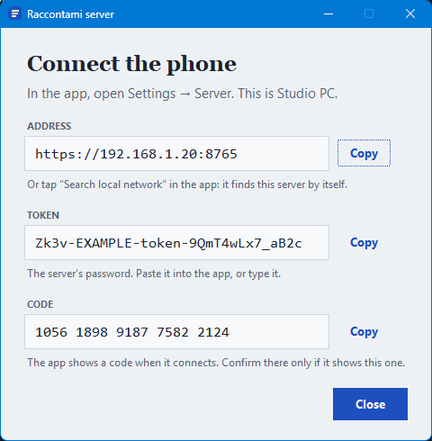
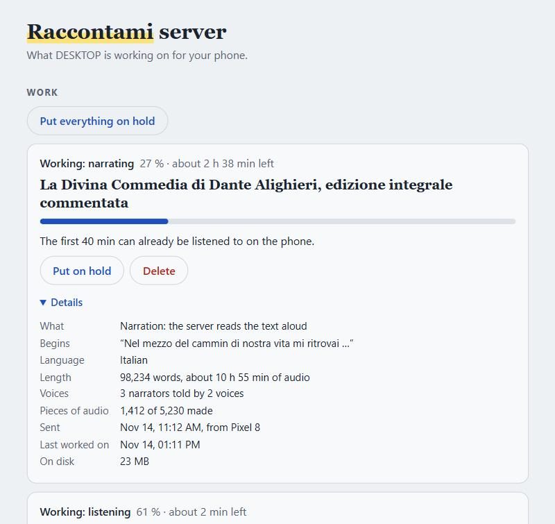

# Raccontami server

The free companion program of **Raccontami**, the Android reading app that highlights each word of
a book as it is spoken. It runs on a PC with an NVIDIA graphics card.

**The app works without it.** Reading is free, and the app can line up an audiobook with its text
on the phone itself. The server is the faster way to do that, and the only way to have a text
read aloud when there is no audiobook:

| Job | What it does | Speed on an RTX 5080 |
|---|---|---|
| **Sync** | lines up an audiobook you already have with its text, word by word | a few minutes per book |
| **Narrate** | reads a text aloud with a natural voice (English and Italian), then syncs it | ~1 h of work per 3 h of audio |
| **Phone models** | a second source for the speech models the app uses to sync on the phone (the app downloads them from GitHub first) | – |

**Contents:** [Install](#install) · [What you need](#what-you-need) · [Connect this phone](#connect-this-phone) ·
[Day to day](#day-to-day) · [Your network](#your-network) · [Voices](#voices) · [Settings](#settings) ·
[Troubleshooting](#troubleshooting) · [How it works](#how-it-works)

## Install

**Came here from the app's button "1 · Get the server for your PC"?** These steps are for the PC,
not the phone. Open this page on the PC: **github.com/alessandrobelli/raccontami-server**

### What you need

- A Windows 10 or 11 PC with an **NVIDIA graphics card** (8 GB or more) and its driver, version
  570 or newer.
- **35 GB** of free disk space (the 20 GB of models can go on another drive), and an internet
  connection for a download of about 35 GB.
- Nothing else: the installer brings what it needs.

No NVIDIA card, or a Mac? The server does not run there. Sync on the phone instead: in the app,
**Settings → Sync → On this phone**.

| | Minimum | Recommended |
|---|---|---|
| GPU | NVIDIA, 8 GB with `RACCONTAMI_ONE_JOB=1` | 12–16 GB |
| Driver | 570 or newer (it brings CUDA 12.8; required for RTX 50) | latest |
| Disk | 35 GB | 50 GB on a fast drive, plus room for finished work (see [Disk space](#disk-space)) |
| Software | Windows: nothing, the installer brings its own. Linux: Python 3.12, ffmpeg, git | |

The Windows installer checks the graphics card, its driver and the free space before it downloads
anything, and stops with a message that says what is missing.

Status: tested on Windows 11 with an RTX 5080. The Linux installer and the Docker image follow the
same steps but have not been run on real hardware yet; reports welcome.

### Windows

1. **Download the installer: [Raccontami-Server-Setup.exe](https://github.com/alessandrobelli/raccontami-server/releases/download/installer/Raccontami-Server-Setup.exe)**.
2. **Open it** from your downloads. Windows may show *Windows protected your PC*, because the
   installer is not signed: click **More info**, then **Run anyway**. To check the download first,
   see the [code signing policy](#code-signing-policy).
3. **Follow its pages.** Next on each one gives the usual answers.
   - **Folder:** where the server goes, usually `C:\Users\<you>\raccontami`. Its code, its own
     Python and ffmpeg, and its Python packages (about 15 GB) go there. Nothing is installed in
     Windows itself, and no administrator is needed.
   - **Models:** the speech and voice models can go on another drive, for example
     `E:\raccontami-models`.
   - **Languages:** the languages of your books (see [Languages](#languages)). Only what they need is
     downloaded: English alone is about 17 GB in all, each further language adds a little over 1 GB,
     plus about 10 GB when it needs a voice model not chosen yet. The box under the list names every
     model the ticked languages use. The free space is checked on each drive.
   - **Narrator** (only for a language whose narrator is made on your PC): how it should sound, see
     [Narrators made on your PC](#languages).
   - **Graphics card** (only when the PC has several NVIDIA cards, or none that is suitable): which
     card the server works on, or why none can be used. The choice is kept as `RACCONTAMI_GPUS`.
   - **Phones on your home network:** adds a Windows firewall rule, for which Windows asks an
     administrator's permission once.
   - **Start at login:** the server then starts without a window, as an icon next to the clock.

   A second window then downloads the Python packages and the models: around half an hour on a
   fast connection, hours on a slow one. If it stops, open the installer again: what is done is kept.
4. **When it works**, leave **Start the server now** ticked: a window titled *Raccontami server*
   shows, under **CONNECT THE PHONE**, the three things the phone needs: the **Address** (like
   `https://192.168.1.20:8765`), the **Token** (the server's password) and a **Code** of twenty
   digits. Started without a window, the same is under **Connect the phone** in the menu of its
   icon next to the clock.
5. Go on with [Connect this phone](#connect-this-phone).

To start the server later: Start menu, **Raccontami server** (without a window) or **Raccontami
server (with a window)**.

With git, Python 3.12 and ffmpeg already installed, the installer can also be run from a clone:

```powershell
git clone https://github.com/alessandrobelli/raccontami-server
cd raccontami-server
powershell -ExecutionPolicy Bypass -File install\install-windows.ps1 -RaccontamiHome D:\raccontami
```

Add `-ModelsDir E:\raccontami-models` to put the models on another drive. For a scripted install
with the `.exe`: `Raccontami-Server-Setup.exe /SILENT /DIR="D:\raccontami" /MODELSDIR="E:\raccontami-models"`.

**Where the models are.** A models folder chosen when installing is written in `settings.txt` as
`RACCONTAMI_MODELS`, and the server and later installs use it from then on; installing again does
not ask again. To move the models later: stop the server, move the folder and add or change that
line. A `RACCONTAMI_MODELS` set on the computer itself wins over the file, for the installer as for
the server. A chosen folder holds every model, even when `HF_HOME` is set on the computer (some
machine-learning tools set it); with no folder chosen, a set `HF_HOME` keeps the Hugging Face
models, nearly all of the 20 GB, and the installer says so. A server that had both set
before version 0.3.1 kept those models in `HF_HOME`: to avoid downloading them again, move the
`hub` folder from there into `<models folder>\hf`.

### Linux

```bash
git clone https://github.com/alessandrobelli/raccontami-server && cd raccontami-server
RACCONTAMI_HOME=/srv/raccontami ./install/install-linux.sh --service
```

Add `RACCONTAMI_MODELS=/big/disk/raccontami-models` in front to put the models elsewhere; it is
kept in `settings.txt` the same way.

`--service` installs a systemd service that starts at boot and restarts after a crash. Without it,
start the server with `/srv/raccontami/start-server.sh`.

### Rented GPU (Docker)

```bash
docker build -f docker/Dockerfile -t raccontami-server .
docker run --gpus all -p 8765:8765 -v raccontami-data:/data raccontami-server
```

Pick a GPU with 16–24 GB (RTX 4090, L4, A5000 or similar). A 4090-class GPU narrates a
10-hour book in about 3.5–4 hours. Stop the machine afterwards: the app has already
downloaded the result.

The first start downloads ~20 GB of models into `/data`, and the server answers only when
that is done. `docker logs -f <container>` shows the download, and then the token and the
pairing code. **Mount a persistent volume on `/data`**, so models, unfinished narrations, the
token and the certificate survive the machine being stopped. Without one, every restart
downloads the models again and the app has to be paired again.

**Keep port 8765 off the open internet.** Two ways to reach the server from the phone:

- **[Tailscale](https://tailscale.com)**: install it on the server and on the phone, and use
  the server's Tailscale address in the app (`https://100.x.y.z:8765`). The app is paired once,
  as on a home network.
- **An HTTPS reverse proxy with a domain**: the proxy does the encryption, so start the server
  with `RACCONTAMI_TLS=0` (in Docker: `-e RACCONTAMI_TLS=0`) and let only the proxy reach port
  8765. With Caddy: `raccontami.example.com { reverse_proxy localhost:8765 }`. Enter
  `https://raccontami.example.com` in the app; there is no pairing code, because the
  certificate is a public one.

Never publish the port with `RACCONTAMI_TLS=0` and nothing in front: the token travels
unencrypted with every request.

### Phone models (optional)

The app downloads the speech models it uses to sync on the phone from this project's GitHub release,
one per language (English about 95 MB, Italian about 317 MB). It asks the server only when that
download fails, and takes the server's copy only if it is the very same file. So the installers do
not build them any more; a server that already has them keeps offering them. A copy built on another
computer may differ from the published file (other library versions); the app then refuses it, so at
worst this fallback does not help, and a wrong model is never used.

Turn this on only for a phone that can reach this computer but not GitHub, such as one on a network
without internet. It takes a few minutes of processor work, a few GB of memory while it runs, and
about 400 MB of disk:

- Windows, from a clone: add `-PhoneModels` to the install command. After the `.exe` installer, in
  PowerShell (for another folder than the usual one, change both paths and first set
  `$env:RACCONTAMI_HOME` to that folder):
  ```powershell
  & "$env:USERPROFILE\raccontami\env\Scripts\python.exe" "$env:USERPROFILE\raccontami\raccontami-server\tools\export_phone_model.py" facebook/wav2vec2-base-960h
  ```
  and the same line again with `jonatasgrosman/wav2vec2-large-xlsr-53-italian` at the end.
- Linux: add `--phone-models` to the install command.
- Docker: add `-e RACCONTAMI_PHONE_MODELS=1` to `docker run`.

## Connect this phone

This is the app's button **2 · Connect this phone**. Keep the server running on the PC, and the phone
on the same Wi-Fi. The server shows what the app asks for: in its window, or, started without a
window, under **Connect the phone** in the menu of the icon next to the clock, where each can be
copied.



1. In the app, open **Settings → Server**. (The button **2 · Connect this phone** leads there; from
   the app's first screen it opens Settings, then tap **Server**.)
2. Tap **Search local network**, then tap your server in the list. If it is not found, type the
   **Address** the server shows, like `https://192.168.1.20:8765`.
3. The app asks **Is this your server?** and shows a code of twenty digits, like
   `0458 4939 0331 2265 6608`. Compare it with the server's **Code**. The same: tap **It is the
   same**. Different: something between the phone and the computer is pretending to be the server;
   do not continue. (With a typed address, this question comes after step 4.)
4. Under **Token**, paste or type the server's token and tap **Test and save**. The app answers
   *Connected to* the server's name and its graphics card.

The app uses the server's name in its messages ("Narrate it on Studio PC"). Change it under
**Name** on the same page, or for every phone with `RACCONTAMI_NAME` in the [settings](#settings).

## Day to day

### The page



Open the server's address in a browser and type the token once. On the same computer that is
`https://localhost:8765/`; the browser warns once, because the certificate is the server's own.
The page shows what the server is working on. Each job can be put on hold, continued or deleted.
It is in English, Italian or Turkish: it follows the browser, and the three names at its foot
switch it.

- **On hold** stops a narration within seconds and keeps every finished piece. It is the way to
  leave the graphics card to something else for a while without stopping the server.
- **A sync that is running** cannot be put on hold; it ends by itself, usually within minutes.
- **Finished** jobs are listed with the room they take, and can be deleted there.

### The icon next to the clock (Windows)

Windows may keep it behind the small arrow there. Its colour says whether the server is working, on
hold or idle. A click opens the page. Its menu has **Connect the phone**, puts everything on hold,
continues it, and stops the server. `RACCONTAMI_TRAY=0` switches the icon off.

### With or without a window

- **In a window** (`start-server.bat`): the window shows what happens. Closing it stops the server.
- **Without a window** (the shortcut, or at login): the server lives next to the clock only, so
  there is no window to close by mistake in the middle of a narration. A notification says it has
  started. What the window would have shown is in `server-data/window.log`.

Only one server runs on a data folder: a second start says so and ends.

### After a restart

Nothing made so far is lost: a narration goes on from the last finished paragraph. Who starts it
again depends on how the server starts:

| Started | Unfinished work |
|---|---|
| In a window | The server asks about each job: continue, delete, or keep on hold. Without an answer within a minute (`RACCONTAMI_ASK_SECONDS`, 0 = wait for ever) work that was running continues, and nothing is deleted |
| Without a window | It waits on hold, so the graphics card is not taken unasked at login. The icon says so; continue from its menu or the page |
| As a service, or in Docker | It continues by itself |

Stopping the server from the icon leaves a narration to be asked about at the next start, instead
of marking it as failed.

### Sleep

While a sync or a narration runs, the server keeps Windows from going to sleep by itself; when the
work ends or is put on hold, the computer sleeps as usual. Closing a laptop's lid still puts it to
sleep: the narration then continues when it wakes. `RACCONTAMI_KEEP_AWAKE=0` switches this off.

### Using the computer while it works

A sync or a narration takes the whole graphics card, which can make the computer slow to use. At
the top of the server's page, **Graphics card** sets how much of it the work may take: **Full
speed**, **Half** or **A quarter**. Below full, the work pauses after each step (a window of audio,
a sentence of a narration) for as long as the share asks: at half, it rests as long as it worked.
The change applies at once, also to a job that is running, and lasts until the server stops; the
setting `RACCONTAMI_GPU_SHARE` gives the share at each start.

The work takes longer in the same proportion: at half, about twice as long. The models still use
the same graphics memory, so for a game that needs all of it, **Put everything on hold** is still
the better choice.

### Listening before the end

While a long book is narrated, the finished beginning is published in growing parts (a quarter of
the book or 10 minutes, then doubling), so listening can start within minutes.

### Disk space

A finished sync keeps the audiobook that was sent. A finished narration keeps its final file, about
30 MB per narrated hour; while it is being made it also holds its pieces of audio, about 200–350 MB
per hour, which are deleted when it is finished. Kept jobs are answered at once when the same story
is sent again. The phone has its own copy once it has
downloaded a story, so jobs for books already on the phone can be deleted: on the page, under
**Finished**.

### Updating

The server's page says which version it is, and **Check for a newer version** there asks GitHub
whether there is a later one. It asks only when the button is pressed; the server itself never
looks.

To update on Windows, stop the server, download the installer again from the same link (it always
gives the newest version) and open it: it finds the folder by itself and brings the new code and what
is missing. Your settings, token, certificate, jobs and narrators are kept, and Python packages that did
not change are not installed again, so an update without new languages takes a minute or two. With a
git clone instead: `git pull`,
then the install script again (the same on Linux).

### Removing it

On Windows: **Settings → Apps → Installed apps → Raccontami server → Uninstall**. It removes the
server's code, its Python, ffmpeg, the Python packages and the shortcuts, offers to remove the
firewall rule, and asks before deleting the models and the server's data (keep the data to
reinstall later without connecting the phone again).

Installed with a script instead (Linux, or Windows from a clone): stop the server and delete the
home folder (and the `raccontami-server` clone, if you made one), and the models folder if you chose
one elsewhere (the `RACCONTAMI_MODELS` line in `settings.txt`). On Windows, also delete the shortcut
in `shell:startup` (Win+R) if you had it start at login, and the firewall rule "Raccontami 8765" in
*Windows Defender Firewall with Advanced Security → Inbound Rules*.

## Your network

The app and the server talk over an encrypted link. The server makes its own certificate the first
time it starts and keeps it in its data folder. Nobody vouches for a computer at home, so the app
does not ask who signed the certificate: it remembers the one it was paired with, by the code you
compared.

- **Plain HTTP** (`RACCONTAMI_TLS=0`): anyone on the same network can read the token and the text as
  they pass, and then use the server with that token. Use it only on a network you trust, or behind
  something that encrypts for you: [Tailscale](https://tailscale.com) between the computer and the
  phone, or an HTTPS reverse proxy.
- **A new certificate** (the two `tls-*.pem` files in the data folder were deleted, or the data
  folder is new): the app refuses to connect until you pair it again. That is on purpose.
- **After an update from a version without the encrypted link**, run the installer again. The
  server then answers on `https://`, and the app has to be paired once: search the network again,
  or tap **Test and save** with the old address. Either way the app finds the encrypted link and
  asks you to compare the code.
- **An app older than the encrypted link** cannot connect to an encrypted server. Update the app, or
  set `RACCONTAMI_TLS=0` to stay on plain HTTP for now.

## Privacy

The server works on your computer. Your books, audiobooks, narrations and reading positions stay on
it and on the phones you pair with it; nothing is sent to the author or to any analytics service,
and there are no accounts.

The server and its installer go on the internet only for these:

- **Installing and updating:** the Python packages (from [PyPI](https://pypi.org) and
  [download.pytorch.org](https://download.pytorch.org)), ffmpeg (from GitHub) and the models (from
  [Hugging Face](https://huggingface.co), and Whisper from OpenAI's download server).
- **Loading and adding models:** the Hugging Face library may ask Hugging Face whether a model it
  has changed, and the server page's **Add** downloads a language's model. Usage reports to Hugging
  Face are turned off.
- **Check for a newer version:** the server's page reads `version.json` from GitHub, only when you
  press that button.

Each of these sites keeps its own logs (your IP address, the file asked for) under its own privacy
policy.

## Voices

| Language | Voice | Licence |
|---|---|---|
| Italian | [VoxCPM2](https://huggingface.co/openbmb/VoxCPM2), cloned from `voices/voxcpm2_it_ref.wav` so every chapter has the same narrator | Apache 2.0 |
| English | [Qwen3-TTS 1.7B CustomVoice](https://huggingface.co/Qwen/Qwen3-TTS-12Hz-1.7B-CustomVoice), speaker *Aiden*, run with [faster-qwen3-tts](https://pypi.org/project/faster-qwen3-tts/) | Apache 2.0 |

They were chosen in a blind listening test against Piper, Kokoro, Chatterbox, Google's phone
voices and others. To change a voice, create `<home>/server-data/voices.json`:

```json
{
  "it": { "voice": "D:\\voices\\my_narrator.wav", "label": "My narrator" },
  "en": { "speaker": "ryan", "label": "Qwen3-TTS · Ryan" }
}
```

A cloned voice needs 10–15 s of one clear speaker, no music. Qwen3-TTS speakers: aiden, dylan,
eric, ono_anna, ryan, serena, sohee, uncle_fu, vivian. A new voice means new narrations;
finished ones are kept. The same text with the same voice is never narrated twice: the
finished result is reused.

A voice can also use another model of the same family, with `"model"` (its Hugging Face id):

```json
{
  "en": { "model": "Qwen/Qwen3-TTS-12Hz-0.6B-CustomVoice", "label": "Qwen3-TTS 0.6B · Aiden" }
}
```

A smaller model fits a smaller GPU; a different one means new narrations, as above. The models
must load with the same library as the voice they replace (VoxCPM for Italian, faster-qwen3-tts
for English). Only the models in the table have been tried; the 0.6B one above is an untested
example. `tools/prefetch.py` downloads only the models in the table.

The included Italian voice sample was generated by VoxCPM2 itself; it is not a recording of a
real person.

## Languages

The installer asks which languages to install; the server syncs and narrates only those. The list is
in [raccontami_sync/languages.py](raccontami_sync/languages.py). Each language has a speech model that
times every word and, to be read aloud, a voice:

| Language | Word timing | Voice | Tried on whole books |
|---|---|---|---|
| English | [facebook/wav2vec2-large-960h-lv60-self](https://huggingface.co/facebook/wav2vec2-large-960h-lv60-self) | Qwen3-TTS | yes |
| Italian | [jonatasgrosman/wav2vec2-large-xlsr-53-italian](https://huggingface.co/jonatasgrosman/wav2vec2-large-xlsr-53-italian) | VoxCPM2 (Qwen3-TTS without it) | yes |
| Spanish | [jonatasgrosman/wav2vec2-large-xlsr-53-spanish](https://huggingface.co/jonatasgrosman/wav2vec2-large-xlsr-53-spanish) | Qwen3-TTS | new |
| Turkish | [mpoyraz/wav2vec2-xls-r-300m-cv7-turkish](https://huggingface.co/mpoyraz/wav2vec2-xls-r-300m-cv7-turkish) (CC BY 4.0, by Muhammet Poyraz) | VoxCPM2, narrator made on your PC | new |
| German | [jonatasgrosman/wav2vec2-large-xlsr-53-german](https://huggingface.co/jonatasgrosman/wav2vec2-large-xlsr-53-german) | Qwen3-TTS | new |
| French | [jonatasgrosman/wav2vec2-large-xlsr-53-french](https://huggingface.co/jonatasgrosman/wav2vec2-large-xlsr-53-french) | Qwen3-TTS | new |
| Portuguese | [jonatasgrosman/wav2vec2-large-xlsr-53-portuguese](https://huggingface.co/jonatasgrosman/wav2vec2-large-xlsr-53-portuguese) | Qwen3-TTS | new |
| Russian | [jonatasgrosman/wav2vec2-large-xlsr-53-russian](https://huggingface.co/jonatasgrosman/wav2vec2-large-xlsr-53-russian) | Qwen3-TTS | new |
| Arabic | [jonatasgrosman/wav2vec2-large-xlsr-53-arabic](https://huggingface.co/jonatasgrosman/wav2vec2-large-xlsr-53-arabic) | VoxCPM2, narrator made on your PC | new |
| Danish | [Alvenir/wav2vec2-base-da-ft-nst](https://huggingface.co/Alvenir/wav2vec2-base-da-ft-nst) | VoxCPM2, narrator made on your PC | new |
| Dutch | [jonatasgrosman/wav2vec2-large-xlsr-53-dutch](https://huggingface.co/jonatasgrosman/wav2vec2-large-xlsr-53-dutch) | VoxCPM2, narrator made on your PC | new |
| Finnish | [Finnish-NLP/wav2vec2-xlsr-300m-finnish-lm](https://huggingface.co/Finnish-NLP/wav2vec2-xlsr-300m-finnish-lm) | VoxCPM2, narrator made on your PC | new |
| Greek | [lighteternal/wav2vec2-large-xlsr-53-greek](https://huggingface.co/lighteternal/wav2vec2-large-xlsr-53-greek) | VoxCPM2, narrator made on your PC | new |
| Hebrew | [imvladikon/wav2vec2-xls-r-300m-lm-hebrew](https://huggingface.co/imvladikon/wav2vec2-xls-r-300m-lm-hebrew) | VoxCPM2, narrator made on your PC | new |
| Hindi | [Harveenchadha/hindi_base_wav2vec2](https://huggingface.co/Harveenchadha/hindi_base_wav2vec2) | VoxCPM2, narrator made on your PC | new |
| Indonesian | [indonesian-nlp/wav2vec2-indonesian-javanese-sundanese](https://huggingface.co/indonesian-nlp/wav2vec2-indonesian-javanese-sundanese) | VoxCPM2, narrator made on your PC | new |
| Norwegian | [NbAiLab/nb-wav2vec2-300m-bokmaal](https://huggingface.co/NbAiLab/nb-wav2vec2-300m-bokmaal) | VoxCPM2, narrator made on your PC | new |
| Polish | [jonatasgrosman/wav2vec2-large-xlsr-53-polish](https://huggingface.co/jonatasgrosman/wav2vec2-large-xlsr-53-polish) | VoxCPM2, narrator made on your PC | new |
| Swahili | [Akashpb13/Swahili_xlsr](https://huggingface.co/Akashpb13/Swahili_xlsr) | VoxCPM2, narrator made on your PC | new |
| Swedish | [KBLab/wav2vec2-large-voxrex-swedish](https://huggingface.co/KBLab/wav2vec2-large-voxrex-swedish) (CC0) | VoxCPM2, narrator made on your PC | new |
| Tagalog | [Khalsuu/filipino-wav2vec2-l-xls-r-300m-official](https://huggingface.co/Khalsuu/filipino-wav2vec2-l-xls-r-300m-official) | VoxCPM2, narrator made on your PC | new |
| Vietnamese | [leduytan93/Fine-Tune-XLSR-Wav2Vec2-Speech2Text-Vietnamese](https://huggingface.co/leduytan93/Fine-Tune-XLSR-Wav2Vec2-Speech2Text-Vietnamese) | VoxCPM2, narrator made on your PC | new |

All word-timing models are free for commercial use (Apache 2.0 unless marked). The choice is kept in
`settings.txt` as `RACCONTAMI_LANGUAGES=en,es`; opening the installer again adds or removes languages
(it asks before deleting the files of a language you untick). Without the line, as on a server installed before languages
could be chosen, it is English and Italian. Chinese, Japanese, Korean and Thai are not offered yet:
they write no spaces between words, which the word timing does not handle yet. Malay waits for a
word-timing model that may be used commercially.

**Narrators made on your PC.** VoxCPM2 speaks 30 languages but copies its narrator from a short voice
sample, and only Italian ships one. For the other languages it narrates, the installer asks how the
narrator should sound (a description such as "a deep, slow storyteller", in any language) and VoxCPM2
designs that voice on the graphics card, a few minutes per language after the downloads. The sample is
kept in `server-data\narrators\`. Opening the installer again keeps it, unless **Replace the narrators already made**
is ticked. Your own recording works too: see [Voices](#voices).

**Adding and removing languages later.** The server's page has a **Languages** card. **Remove** takes a
language off the server and deletes its word-timing model and the narrator made for it. When no language
left needs a voice model, the page asks whether to delete that too. **Add** downloads a language's
word-timing model (and makes its narrator, asking how it should sound) when its voice model is already
installed; a language that needs a voice model you don't have says to open the installer again and tick
it. Downloaded models are deleted only inside the server's own models folder: when they live in a Hugging
Face folder other programs share (`HF_HOME`), the language is switched off and its models are kept (the
narrator made for it is still deleted). Opening the
installer again and unticking a language asks the same question: delete its files, or keep them.
A setting adds a language that is not in the list, or changes the model of one. The language code is
the end of the name:

```
RACCONTAMI_ALIGN_MODEL_FR=jonatasgrosman/wav2vec2-large-xlsr-53-french
```

The value is a Hugging Face model name or the folder of a downloaded model. It must be the same
kind of model the phone uses ([docs/phone-models.md](docs/phone-models.md)): a CTC speech model
that writes letters (wav2vec2, HuBERT, WavLM). The server checks it when it starts and does not
start with a model of another kind, with a name Hugging Face does not have, or with a language
Whisper does not know, and its message names the setting that is wrong. The model is
downloaded at the first sync in that language.

- **The app** reads the server's languages from `/v1/health` (`languages` for syncing,
  `narration` for reading aloud) in the versions that support it; older apps send only English
  and Italian stories to the server, and sync others on the phone. A server asked for a language it
  does not have answers in plain words that the phone shows.
- **Narration** needs a voice for the language as well (see [Voices](#voices)).
- **Numbers** in the text are spelled out in words when [num2words](https://pypi.org/project/num2words/)
  knows the language. Otherwise they stay digits, which the model cannot hear: those words take
  their times from the words around them. Apostrophes split words only in Italian
  ("l'amico" is "l amico"), elsewhere they are dropped ("don't" is "dont"). A letter a model does
  not have is spelled out when it can be (German ß as ss), otherwise taken without its accent.
- Only English and Italian have been tried on whole books. A changed model applies to audiobooks
  synced from then on.

## Settings

Settings go in `settings.txt` in the home folder, one per line, as `NAME=value`
(`RACCONTAMI_ONE_JOB=1`). The installer makes the file with the common ones ready to switch on, and
afterwards only adds the models folder chosen when installing, when the file has none; the start files, which it writes anew at every run, are not the place
for settings. The server reads the file when it starts, with or without a window. A setting given
as an environment variable (a service file, `docker run -e`) wins over the file.

| Setting | Default | |
|---|---|---|
| `RACCONTAMI_NAME` | computer name | how the app names this server |
| `RACCONTAMI_GPU_SHARE` | 100 | how much of the graphics card the work may take, in %, from 10 to 100: below 100 it pauses between steps, so the computer stays usable (see [Using the computer while it works](#using-the-computer-while-it-works)). The server's page changes it while it runs |
| `RACCONTAMI_ONE_JOB` | off | `1`: syncs and narrations take turns on the GPU, for GPUs under 12 GB (see below) |
| `RACCONTAMI_TLS` | on | `0`: plain HTTP instead of the encrypted link (see [Your network](#your-network)) |
| `RACCONTAMI_KEEP_AWAKE` | on | `0`: Windows may go to sleep while a job runs |
| `RACCONTAMI_TRAY` | on | `0`: no icon next to the clock |
| `RACCONTAMI_ASK_SECONDS` | 60 | how long a server started in a window waits for an answer about unfinished work; 0 = for ever |
| `RACCONTAMI_HOST`, `RACCONTAMI_PORT` | `0.0.0.0`, `8765` | where the server listens. The installer picks the next free port and writes it here when another program holds 8765; the app's **Search local network** looks on 8765, so on another port type the address the server's window shows |
| `RACCONTAMI_LANGUAGES` | `en,it` | the installed languages (see [Languages](#languages)); the installer sets this line |
| `RACCONTAMI_GPUS` | all | the NVIDIA card(s) the server uses, by their number in `nvidia-smi` (`1`); the installer sets it when the PC has several |
| `RACCONTAMI_TOKEN` | random, saved in token.txt | the app's password |
| `RACCONTAMI_WHISPER_MODEL` | `turbo` | Whisper model for syncs: `small` or `medium` for less graphics memory, `large-v3` for a little more accuracy, several times slower. It only places the anchors (the word times come from wav2vec2), so turbo is enough on any GPU that fits it. Applies to audiobooks synced from then on |
| `RACCONTAMI_ALIGN_MODEL_<XX>` | English, Italian | the model that times the words of language `XX`: adds a language or changes its model (see [Languages](#languages)) |
| `RACCONTAMI_FIRST_PART_S` | 600 | maximum length of a narration's first part, in seconds |
| `RACCONTAMI_HOME` | `~/raccontami` | home folder for everything below (set where the server is started, not in the file) |
| `RACCONTAMI_DATA` | `<home>/server-data` | jobs, token, log, voices.json |
| `RACCONTAMI_MODELS` | `<home>/models` | downloaded models (about 20 GB); the installer writes it when another folder is chosen. When set, it also holds the Hugging Face and PyTorch models; when not, a set `HF_HOME` or `TORCH_HOME` keeps them |
| `RACCONTAMI_ONNX` | `<home>/onnx` | phone models |
| `RACCONTAMI_TTS` | `<home>/tts` | voice environments `env-a` (VoxCPM2), `env-c` (Qwen3-TTS) |
| `RACCONTAMI_CACHE` | `<tts>/cache` | compiled voice kernels |

**Graphics memory.** In use: Whisper turbo ~3 GB (sync), wav2vec2 aligner ~1.5 GB, VoxCPM2 ~6.5 GB
(Italian voice), Qwen3-TTS ~5 GB (English voice). Models leave the GPU after 10 idle minutes. A sync
and a narration run at the same time, which together take up to ~12 GB. With `RACCONTAMI_ONE_JOB=1`
jobs take turns, and Whisper leaves the GPU when a narration starts. The cost is waiting: an
audiobook sent while a book is being narrated starts only when the narration ends, which can be
hours.

## Troubleshooting

| You see | Why, and what to do |
|---|---|
| *Windows protected your PC* when opening the installer | The installer is not signed, so Windows does not know it. Click **More info**, then **Run anyway**. It is built from this repository by GitHub (the *Windows installer* workflow), and its SHA-256 is in `SHA256.txt` on the release page: see the [code signing policy](#code-signing-policy) |
| The installer's second window stops with an error | The lines above the error say which step failed (often the connection, or a full drive). Open the installer again: what is done is kept, and it continues from there |
| The app can't reach the server | Open the server's address in the phone's browser, starting with `https://` (`http://` with `RACCONTAMI_TLS=0`). A reachable server shows a certificate warning, which is expected because the certificate is its own, and then its page. No answer at all: the server is not running, the address or the network is wrong, or the firewall blocks it (next line) |
| The app says "The server refused the token" | The token in the app is not this server's (it changes when `token.txt` in the data folder is deleted, or with `RACCONTAMI_TOKEN`). Copy it again from the server's window or its **Connect the phone** window, and tap **Test and save** |
| The app says "Server error 404: The server no longer has this story …" (before version 0.3.0: "… unknown job") | The server no longer has that job: it was deleted on the server's page, or the server now runs with another data folder. **Retry** in the app sends the story again |
| The page opens on the computer but the phone gets no answer (Windows) | The firewall. Run the installer again and answer yes to its question about phones on your network (or run the `New-NetFirewallRule` line it prints, as administrator). If Windows once asked whether to allow Python and the answer was Cancel, it made rules that block it: open *Windows Defender Firewall with Advanced Security → Inbound Rules* and delete the blocking rules named Python |
| The first narration of a language "prepares the voice" for 3–4 min | VoxCPM2 is compiling; the result is cached, later starts take under a minute |
| Narration below 1× real time | on Windows, `triton-windows` is missing in `tts\env-a` (re-run the installer); or the GPU is busy |
| A narration failed | The page says why when the cause is a known one (graphics memory, a full disk, the driver). The full story is in `<home>/server-data/jobs/<id>/narrate.log`. **Continue** on the page, or Retry in the app, keeps finished paragraphs |
| `property 'upsample' ... has no setter` | wrong transformers in `env-c`: `pip install transformers==5.15.1` |
| Disk filling up | delete finished jobs on the page, under **Finished** (see [Disk space](#disk-space)) |
| Where the logs are | `<home>/server-data/server.log`; started without a window, also `window.log` beside it; as a Linux service, `journalctl -u raccontami` |

## How it works

- **Sync**: Whisper transcribes the audiobook, a matcher finds where the book's words and
  the transcript agree, and wav2vec2 CTC forced alignment times every word between those anchors.
  Scanned-book recognition errors are detected along the way (the narrator says the right word).
- **Narrate**: the text is cut into paragraphs (long ones at sentence ends); a worker in the voice's
  own environment speaks each one at low CPU priority, saving it as soon as it is done; each is
  aligned with its words right away, and a paragraph that does not match the text is read again
  once. Parts and the final file are AAC with the usual sync file.

The three Python environments exist because the voices need library versions that conflict with
each other. The API the app uses is described in [docs/api.md](docs/api.md).

## Licence

Apache 2.0, see [LICENSE](LICENSE). The models are downloaded from their authors under their own
licences, all free for commercial use: Whisper (MIT), wav2vec2 aligners (Apache 2.0; the Turkish
one, by Muhammet Poyraz, CC BY 4.0), VoxCPM2 (Apache 2.0), Qwen3-TTS (Apache 2.0).

## Code signing policy

The Windows installer is not signed: the project has no code-signing certificate yet. That is why
Windows shows *Windows protected your PC* when it is opened (click **More info**, then **Run
anyway**).

The installer is built from this repository's source by GitHub Actions
([.github/workflows/installer.yml](.github/workflows/installer.yml)), not on a personal computer. To
check that your download is that build, compare its SHA-256 with `SHA256.txt` on the
[release page](https://github.com/alessandrobelli/raccontami-server/releases/tag/installer). In
PowerShell, in your downloads folder:

```powershell
Get-FileHash .\Raccontami-Server-Setup.exe
```

If the installer is signed later, only that GitHub build will be signed, and each release only after
a person approves it.

- Committers and reviewers: [Alessandro Belli](https://github.com/alessandrobelli)
- Approvers: [Alessandro Belli](https://github.com/alessandrobelli)

Privacy: see [Privacy](#privacy). This program does not send any information to other networked
systems unless the user asks it to, or as described there.
