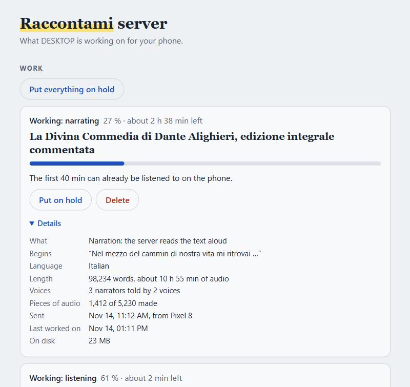
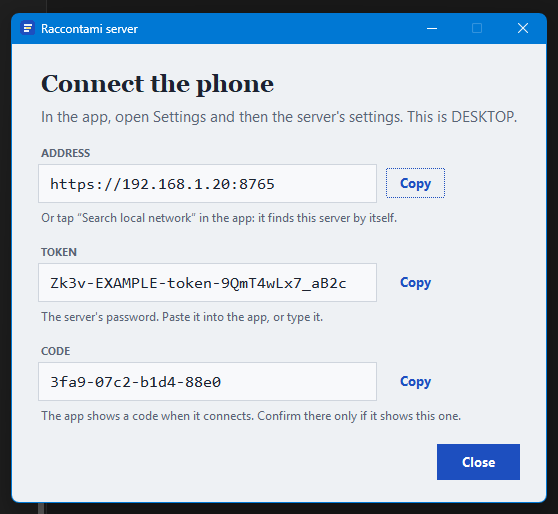

# Raccontami server

The GPU companion of **Raccontami**, a reading app that highlights each word of a book
as it is spoken. It runs on a computer with an NVIDIA graphics card, at home or rented,
and does three jobs for the app:

| Job | What it does | Speed on an RTX 5080 |
|---|---|---|
| **Sync** | lines up an audiobook you already have with its text, word by word | a few minutes per book |
| **Narrate** | reads a text aloud with a natural voice, then syncs it | ~1 h of work per 3 h of audio |
| **Phone models** | serves the small models the app uses to sync on the phone itself | – |



Status: tested on Windows 11 with an RTX 5080. The Linux installer and the Docker image follow the
same steps but have not been run on real hardware yet; reports welcome.

**Contents:** [What you need](#what-you-need) · [Install](#install) · [Connect the app](#connect-the-app) ·
[Day to day](#day-to-day) · [Your network](#your-network) · [Voices](#voices) · [Settings](#settings) ·
[Troubleshooting](#troubleshooting) · [How it works](#how-it-works)

## What you need

| | Minimum | Recommended |
|---|---|---|
| GPU | NVIDIA, 8 GB with `RACCONTAMI_ONE_JOB=1` | 12–16 GB |
| Driver | 570 or newer (it brings CUDA 12.8; required for RTX 50) | latest |
| Disk | 35 GB | 50 GB on a fast drive, plus room for finished work (see [Disk space](#disk-space)) |
| Software | Windows: nothing, the setup brings its own. Linux: Python 3.12, ffmpeg, git | |

The setup checks the driver and the free space before it downloads anything.

## Install

Everything goes into one home folder (default `~/raccontami`, or `%USERPROFILE%\raccontami`). The
installers download about 35 GB and are safe to stop and run again: they only add what is missing.

### Windows

1. Start the setup, in one of two ways:
   - Open **PowerShell** (Start menu, type "PowerShell") and paste this line:
     ```powershell
     irm https://raw.githubusercontent.com/alessandrobelli/raccontami-server/main/install/setup.ps1 | iex
     ```
   - Or download [Install Raccontami server.cmd](https://github.com/alessandrobelli/raccontami-server/raw/main/Install%20Raccontami%20server.cmd)
     and double-click it. Windows warns about a file from the internet that it does not know:
     choose **More info**, then **Run anyway**. The first way has no such warning.

   The setup asks where to put everything, then brings what the computer does not have: the
   server's code, a Python of its own and ffmpeg. All of it goes into that one folder, nothing is
   installed in Windows itself, and no administrator is needed for it.
2. At the end the installer asks three questions. Yes to all three is the usual answer; a no can
   be changed later, and its last lines say how.
   - **May phones on your home network reach the server?** It adds a Windows firewall rule, for
     which Windows asks an administrator's permission.
   - **Start the server at login?** It then runs without a window, as an icon next to the clock.
   - **Start the server now?** Its window opens.
3. Go on with [Connect the app](#connect-the-app).

To start the server yourself, double-click `start-server.bat` in the folder you chose, or
`Raccontami server (no window)` beside it.

With git, Python 3.12 and ffmpeg already installed, the installer can also be run from a clone:

```powershell
git clone https://github.com/alessandrobelli/raccontami-server
cd raccontami-server
powershell -ExecutionPolicy Bypass -File install\install-windows.ps1 -RaccontamiHome D:\raccontami
```

### Linux

```bash
git clone https://github.com/alessandrobelli/raccontami-server && cd raccontami-server
RACCONTAMI_HOME=/srv/raccontami ./install/install-linux.sh --service
```

`--service` installs a systemd service that starts at boot and restarts after a crash. Without it,
start the server with `/srv/raccontami/start-server.sh`.

### Rented GPU (Docker)

```bash
docker build -f docker/Dockerfile -t raccontami-server .
docker run --gpus all -p 8765:8765 -v raccontami-data:/data raccontami-server
```

Pick a GPU with 16–24 GB (RTX 4090, L4, A5000 or similar). A 4090-class GPU narrates a
10-hour book in about 3.5–4 hours. Stop the machine afterwards: the app has already
downloaded the result.

The first start downloads ~20 GB of models into `/data`, and the server answers only when
that is done. `docker logs -f <container>` shows the download, and then the token and the
pairing code. **Mount a persistent volume on `/data`**, so models, unfinished narrations, the
token and the certificate survive the machine being stopped. Without one, every restart
downloads the models again and the app has to be paired again.

**Keep port 8765 off the open internet.** Two ways to reach the server from the phone:

- **[Tailscale](https://tailscale.com)**: install it on the server and on the phone, and use
  the server's Tailscale address in the app (`https://100.x.y.z:8765`). The app is paired once,
  as on a home network.
- **An HTTPS reverse proxy with a domain**: the proxy does the encryption, so start the server
  with `RACCONTAMI_TLS=0` (in Docker: `-e RACCONTAMI_TLS=0`) and let only the proxy reach port
  8765. With Caddy: `raccontami.example.com { reverse_proxy localhost:8765 }`. Enter
  `https://raccontami.example.com` in the app; there is no pairing code, because the
  certificate is a public one.

Never publish the port with `RACCONTAMI_TLS=0` and nothing in front: the token travels
unencrypted with every request.

## Connect the app

The app asks for three things. The server shows all three when it starts: in its window, or, started
without a window, under **Connect the phone** in the menu of the icon next to the clock, where each
can be copied.



1. On the phone, on the same Wi-Fi, open **Settings**, then the server's settings.
2. Tap **Search local network** and pick your server. (Or type the **address** the server shows,
   like `https://192.168.1.20:8765`.)
3. The app shows a **code** of twenty digits, like `0458 4939 0331 2265 6608`. Compare it with the
   server's. The same: confirm. Different: something between the phone and the computer is
   pretending to be the server; do not confirm. (Until version 0.2 the same code was written with
   letters, like `3fa9-07c2-b1d4-88e0`. The app and the server each show both forms, so one that
   is not yet updated can still be paired with one that is.)
4. Enter the **token**, the server's password, and tap **Test and save**. The app answers with the
   server's name and graphics card.

The app uses the server's name in its messages ("Narrate it on Studio PC"). Change it under
**Name** in the app, or for every phone with `RACCONTAMI_NAME` in the [settings](#settings).

## Day to day

### The page

Open the server's address in a browser and type the token once. On the same computer that is
`https://localhost:8765/`; the browser warns once, because the certificate is the server's own.
The page shows what the server is working on. Each job can be put on hold, continued or deleted.
It is in English, Italian or Turkish: it follows the browser, and the three names at its foot
switch it.

- **On hold** stops a narration within seconds and keeps every finished piece. It is the way to
  leave the graphics card to something else for a while without stopping the server.
- **A sync that is running** cannot be put on hold; it ends by itself, usually within minutes.
- **Finished** jobs are listed with the room they take, and can be deleted there.

### The icon next to the clock (Windows)

Windows may keep it behind the small arrow there. Its colour says whether the server is working, on
hold or idle. A click opens the page. Its menu has **Connect the phone**, puts everything on hold,
continues it, and stops the server. `RACCONTAMI_TRAY=0` switches the icon off.

### With or without a window

- **In a window** (`start-server.bat`): the window shows what happens. Closing it stops the server.
- **Without a window** (the shortcut, or at login): the server lives next to the clock only, so
  there is no window to close by mistake in the middle of a narration. A notification says it has
  started. What the window would have shown is in `server-data/window.log`.

Only one server runs on a data folder: a second start says so and ends.

### After a restart

Nothing made so far is lost: a narration goes on from the last finished paragraph. Who starts it
again depends on how the server starts:

| Started | Unfinished work |
|---|---|
| In a window | The server asks about each job: continue, delete, or keep on hold. Without an answer within a minute (`RACCONTAMI_ASK_SECONDS`, 0 = wait for ever) work that was running continues, and nothing is deleted |
| Without a window | It waits on hold, so the graphics card is not taken unasked at login. The icon says so; continue from its menu or the page |
| As a service, or in Docker | It continues by itself |

Stopping the server from the icon leaves a narration to be asked about at the next start, instead
of marking it as failed.

### Sleep

While a sync or a narration runs, the server keeps Windows from going to sleep by itself; when the
work ends or is put on hold, the computer sleeps as usual. Closing a laptop's lid still puts it to
sleep: the narration then continues when it wakes. `RACCONTAMI_KEEP_AWAKE=0` switches this off.

### Listening before the end

While a long book is narrated, the finished beginning is published in growing parts (a quarter of
the book or 10 minutes, then doubling), so listening can start within minutes.

### Disk space

A finished sync keeps the audiobook that was sent. A finished narration keeps its final file, about
30 MB per narrated hour; while it is being made it also holds its pieces of audio, about 200–350 MB
per hour, which are deleted when it is finished. Kept jobs are answered at once when the same story
is sent again. The phone has its own copy once it has
downloaded a story, so jobs for books already on the phone can be deleted: on the page, under
**Finished**.

### Updating

The server's page says which version it is, and **Check for a newer version** there asks GitHub
whether there is a later one. It asks only when the button is pressed; the server itself never
looks.

To update, stop the server and run the setup again, the same way as the first time, with the same
folder. It brings the new code and adds what is missing. Your settings, token, certificate and
jobs are kept. With a git clone instead: `git pull`, then the install script again (the same on
Linux).

### Removing it

Stop the server and delete the home folder (and the `raccontami-server` clone, if you made one).
The Python and the ffmpeg that the setup brought are inside the home folder and go with it. On Windows, also
delete the shortcut in `shell:startup` (Win+R) if you had it start at login, and the firewall rule
"Raccontami 8765" in *Windows Defender Firewall with Advanced Security → Inbound Rules*.

## Your network

The app and the server talk over an encrypted link. The server makes its own certificate the first
time it starts and keeps it in its data folder. Nobody vouches for a computer at home, so the app
does not ask who signed the certificate: it remembers the one it was paired with, by the code you
compared.

- **Plain HTTP** (`RACCONTAMI_TLS=0`): anyone on the same network can read the token and the text as
  they pass, and then use the server with that token. Use it only on a network you trust, or behind
  something that encrypts for you: [Tailscale](https://tailscale.com) between the computer and the
  phone, or an HTTPS reverse proxy.
- **A new certificate** (the two `tls-*.pem` files in the data folder were deleted, or the data
  folder is new): the app refuses to connect until you pair it again. That is on purpose.
- **After an update from a version without the encrypted link**, run the installer again. The
  server then answers on `https://`, and the app has to be paired once: search the network again,
  or change the address in the app from `http://` to `https://`.
- **An app older than the encrypted link** cannot connect to an encrypted server. Update the app, or
  set `RACCONTAMI_TLS=0` to stay on plain HTTP for now.

## Voices

| Language | Voice | Licence |
|---|---|---|
| Italian | [VoxCPM2](https://huggingface.co/openbmb/VoxCPM2), cloned from `voices/voxcpm2_it_ref.wav` so every chapter has the same narrator | Apache 2.0 |
| English | [Qwen3-TTS 1.7B CustomVoice](https://huggingface.co/Qwen/Qwen3-TTS-12Hz-1.7B-CustomVoice), speaker *Aiden*, run with [faster-qwen3-tts](https://pypi.org/project/faster-qwen3-tts/) | Apache 2.0 |

They were chosen in a blind listening test against Piper, Kokoro, Chatterbox, Google's phone
voices and others. To change a voice, create `<home>/server-data/voices.json`:

```json
{
  "it": { "voice": "D:\\voices\\my_narrator.wav", "label": "My narrator" },
  "en": { "speaker": "ryan", "label": "Qwen3-TTS · Ryan" }
}
```

A cloned voice needs 10–15 s of one clear speaker, no music. Qwen3-TTS speakers: aiden, dylan,
eric, ono_anna, ryan, serena, sohee, uncle_fu, vivian. A new voice means new narrations;
finished ones are kept. The same text with the same voice is never narrated twice: the
finished result is reused.

A voice can also use another model of the same family, with `"model"` (its Hugging Face id):

```json
{
  "en": { "model": "Qwen/Qwen3-TTS-12Hz-0.6B-CustomVoice", "label": "Qwen3-TTS 0.6B · Aiden" }
}
```

A smaller model fits a smaller GPU; a different one means new narrations, as above. The models
must load with the same library as the voice they replace (VoxCPM for Italian, faster-qwen3-tts
for English). Only the models in the table have been tried; the 0.6B one above is an untested
example. `tools/prefetch.py` downloads only the models in the table.

The included Italian voice sample was generated by VoxCPM2 itself; it is not a recording of a
real person.

## Settings

Settings go in `settings.txt` in the home folder, one per line, as `NAME=value`
(`RACCONTAMI_ONE_JOB=1`). The installer makes the file with the common ones ready to switch on, and
never changes it afterwards; the start files, which it writes anew at every run, are not the place
for settings. The server reads the file when it starts, with or without a window. A setting given
as an environment variable (a service file, `docker run -e`) wins over the file.

| Setting | Default | |
|---|---|---|
| `RACCONTAMI_NAME` | computer name | how the app names this server |
| `RACCONTAMI_ONE_JOB` | off | `1`: syncs and narrations take turns on the GPU, for GPUs under 12 GB (see below) |
| `RACCONTAMI_TLS` | on | `0`: plain HTTP instead of the encrypted link (see [Your network](#your-network)) |
| `RACCONTAMI_KEEP_AWAKE` | on | `0`: Windows may go to sleep while a job runs |
| `RACCONTAMI_TRAY` | on | `0`: no icon next to the clock |
| `RACCONTAMI_ASK_SECONDS` | 60 | how long a server started in a window waits for an answer about unfinished work; 0 = for ever |
| `RACCONTAMI_HOST`, `RACCONTAMI_PORT` | `0.0.0.0`, `8765` | where the server listens |
| `RACCONTAMI_TOKEN` | random, saved in token.txt | the app's password |
| `RACCONTAMI_WHISPER_MODEL` | `turbo` | Whisper model for syncs: `small` or `medium` for less graphics memory, `large-v3` for a little more accuracy, several times slower. It only places the anchors (the word times come from wav2vec2), so turbo is enough on any GPU that fits it. Applies to audiobooks synced from then on |
| `RACCONTAMI_FIRST_PART_S` | 600 | maximum length of a narration's first part, in seconds |
| `RACCONTAMI_HOME` | `~/raccontami` | home folder for everything below (set where the server is started, not in the file) |
| `RACCONTAMI_DATA` | `<home>/server-data` | jobs, token, log, voices.json |
| `RACCONTAMI_MODELS` | `<home>/models` | downloaded models |
| `RACCONTAMI_ONNX` | `<home>/onnx` | phone models |
| `RACCONTAMI_TTS` | `<home>/tts` | voice environments `env-a` (VoxCPM2), `env-c` (Qwen3-TTS) |
| `RACCONTAMI_CACHE` | `<tts>/cache` | compiled voice kernels |

**Graphics memory.** In use: Whisper turbo ~3 GB (sync), wav2vec2 aligner ~1.5 GB, VoxCPM2 ~6.5 GB
(Italian voice), Qwen3-TTS ~5 GB (English voice). Models leave the GPU after 10 idle minutes. A sync
and a narration run at the same time, which together take up to ~12 GB. With `RACCONTAMI_ONE_JOB=1`
jobs take turns, and Whisper leaves the GPU when a narration starts. The cost is waiting: an
audiobook sent while a book is being narrated starts only when the narration ends, which can be
hours.

## Troubleshooting

| You see | Why, and what to do |
|---|---|
| The app can't reach the server | Open the server's address in the phone's browser, starting with `https://` (`http://` with `RACCONTAMI_TLS=0`). A reachable server shows a certificate warning, which is expected because the certificate is its own, and then its page. No answer at all: the server is not running, the address or the network is wrong, or the firewall blocks it (next line) |
| The page opens on the computer but the phone gets no answer (Windows) | The firewall. Run the installer again and answer yes to its question about phones on your network (or run the `New-NetFirewallRule` line it prints, as administrator). If Windows once asked whether to allow Python and the answer was Cancel, it made rules that block it: open *Windows Defender Firewall with Advanced Security → Inbound Rules* and delete the blocking rules named Python |
| The first narration of a language "prepares the voice" for 3–4 min | VoxCPM2 is compiling; the result is cached, later starts take under a minute |
| Narration below 1× real time | on Windows, `triton-windows` is missing in `tts\env-a` (re-run the installer); or the GPU is busy |
| A narration failed | The page says why when the cause is a known one (graphics memory, a full disk, the driver). The full story is in `<home>/server-data/jobs/<id>/narrate.log`. **Continue** on the page, or Retry in the app, keeps finished paragraphs |
| `property 'upsample' ... has no setter` | wrong transformers in `env-c`: `pip install transformers==5.15.1` |
| Disk filling up | delete finished jobs on the page, under **Finished** (see [Disk space](#disk-space)) |
| Where the logs are | `<home>/server-data/server.log`; started without a window, also `window.log` beside it; as a Linux service, `journalctl -u raccontami` |

## How it works

- **Sync**: Whisper transcribes the audiobook, a matcher finds where the book's words and
  the transcript agree, and wav2vec2 CTC forced alignment times every word between those anchors.
  Scanned-book recognition errors are detected along the way (the narrator says the right word).
- **Narrate**: the text is cut into paragraphs (long ones at sentence ends); a worker in the voice's
  own environment speaks each one at low CPU priority, saving it as soon as it is done; each is
  aligned with its words right away, and a paragraph that does not match the text is read again
  once. Parts and the final file are AAC with the usual sync file.

The three Python environments exist because the voices need library versions that conflict with
each other. The API the app uses is described in [docs/api.md](docs/api.md).

## Licence

Apache 2.0, see [LICENSE](LICENSE). The models are downloaded from their authors under their own
licences, all free for commercial use: Whisper (MIT), wav2vec2 aligners (Apache 2.0), VoxCPM2
(Apache 2.0), Qwen3-TTS (Apache 2.0).
